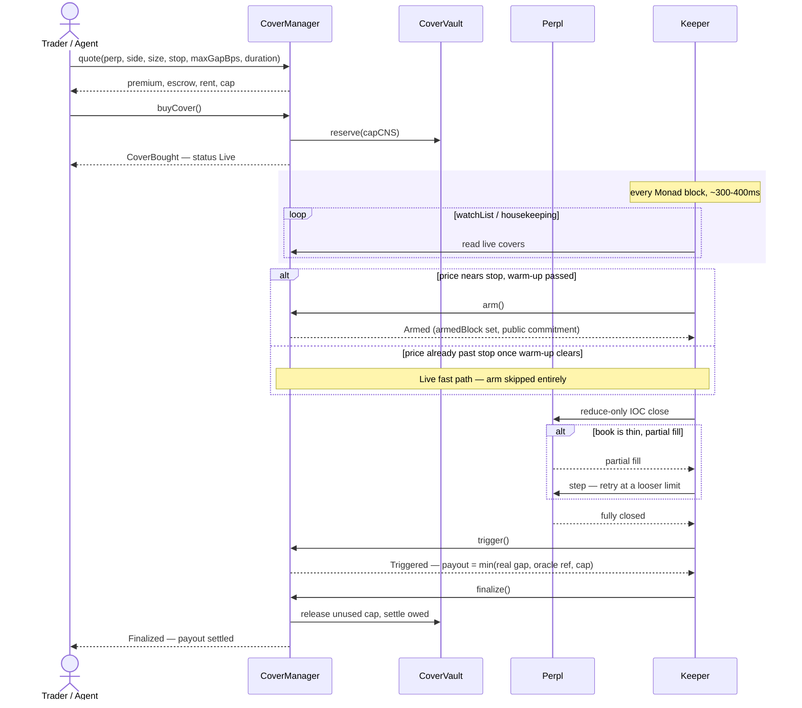
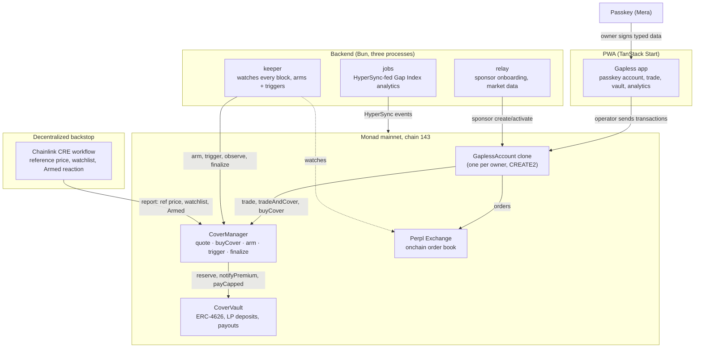

<div align="center">

<picture>
  <source media="(prefers-color-scheme: dark)" srcset="web/public/assets/logo.svg" />
  
</picture>

# Gapless

### Stops that can't slip.

Gapless is a guaranteed stop-loss protocol for **Perpl** perpetuals on **Monad**. Tick "Guarantee" on a stop. If the market gaps through it, a public AUSD vault pays the difference — in the **same transaction** that closes your position.

<br/>


</div>

---

## The problem

Perpl's price oracle lags its own order book. Measured live this week: BTC's mark updates roughly every 50 seconds at the median, and alt-perps show real execution gaps — MON's p95 slippage vs. trigger reached 120bps. A stop-loss that fires on a stale price isn't a stop, it's a suggestion. A missed stop can cascade into a liquidation that costs far more than the gap itself.

Centralized brokers solved this decades ago with a paid "guaranteed stop" product. Nobody has ever been able to sell that guarantee onchain — because no perp venue's order book was itself a smart contract, fast enough to underwrite it atomically.

**This isn't a one-off — it's the same pattern, every few months, headline after headline:**

| Headline | Outlet | Date |
|---|---|---|
| "Crypto Surge Triggers Record $2.7 Billion of Short Liquidations" | Bloomberg | Aug 19, 2026 |
| "Crypto Perpetual Futures See $608M in Liquidations as Ether Longs Unwind" | Crypto Briefing | Oct 7, 2026 |
| "Bitcoin's $2 Billion Reckoning" (396,000 traders liquidated in one day) | Coinchange | Nov 21, 2025 |

And the cost isn't abstract. Measured on Perpl this past week: **$664,526** of real trader money ran through stop-losses with no guarantee behind any of it. On a $10,000 position, MON's worst-case slippage (120bps) is **$120 of a trader's own money gone, instantly — no refund, no appeal.** Scaled across every onchain perp exchange, that's roughly **$3.4B a month** moving through unguaranteed stop-losses, industry-wide.

## The solution

1. A trader opens a position on Perpl and ticks **Guarantee** on their stop.
2. A keeper watches every Monad block (~300-400ms). When price crosses the stop, it **arms** in one block and **triggers** in the next.
3. The position closes with a reduce-only order. If the realized fill is worse than the stop, a public AUSD vault pays the gap — **in the same transaction**.

The payout is bounded three ways so it can't be gamed: the real measured gap, an independent Chainlink-oracle-checked reference, and a cap the trader chose (which also sets their premium). See [`MECHANISM.md`](MECHANISM.md) for the exact formulas, pulled straight from the deployed contract.

**In plain terms, Gapless is insurance for your stop-loss:**
- **Simple to use.** Place your stop like normal, tick "Guarantee," pick your price. No new app to learn, no claims process to figure out later.
- **Paid instantly.** If the market gaps past your stop, you're paid the moment it happens — no claim to file, no one to convince, no waiting.
- **Priced from real data.** Your price is based on what actually happens in this market, not a guess — the same way an insurer prices a policy from real loss history.
- **Backed by real money.** A public pool of investors stands behind every payout, the same way an insurer's capital backs a policy — and they're earning a return for doing it.

It's built for a **$3.4B/month** market — the slice of onchain perp trading that runs through stop-losses with no guarantee behind any of it. On Perpl alone, that's already **~$34.6M a year** in real stop-loss volume Gapless is positioned to protect.

LPs underwrite the risk and earn the premiums — 10% to protocol treasury, 90% compounds into LP share value. That split is a live, deployed contract parameter (`protocolFeeBps = 1000` on `CoverManager` today, checkable with `cast call`), not a design doc. It has also now paid out for real: a guaranteed stop bought on mainnet on 2026-10-12 (cover `0x270e5298…`, tx [`0x713017…`](https://monadvision.com/tx/0x713017066dfc04e62db4e112ba9e3eb74dd4708a4f32ba3f8cda3554455e7132)) was armed-free (fast path), triggered ([`0x56847d…`](https://monadvision.com/tx/0x56847d8c7fffc55dec595a531ab99f71200f394b6cc397a54dc7f145c58c2115)) and finalized ([`0xe00401…`](https://monadvision.com/tx/0xe00401e460f679efa534ab7a72f8864546986c44ccb103769988b52c4a67dfbb)) by the keeper with zero manual intervention after purchase — full lifecycle, start to finish, in under 15 seconds.

---

## The full lifecycle, step by step, with a real example

Every number below is from one real run on Monad mainnet on 2026-10-12 — not a simulation, not a fork, not a mock. Cover `0x270e5298d3fd45e055097dd12d72531ee8a7d87b0520c433c69e980b1e833a46`, bought through the MetaMask Agent Wallet plugin, on a real open BTC long position.



**1. Quote.** The trader (or agent) asks `CoverManager.quote()` for a price: perp, side, size, a stop price, a max covered gap, a duration. The contract reads the live Perpl mark, the posted volatility (`sigma`), and the market's own risk params, and returns a premium.
> Real: BTC long, 0.0001 BTC (10 lots), stop $82,400, mark $82,676.1 at quote time (28bps away, above the market's 12bps minimum distance), max gap 200bps, duration 12,000 blocks (~1 hour). Quoted premium: 0.024205 AUSD (cap 0.024689 AUSD). Escrow 0.004205 AUSD (refundable), rent 0.02 AUSD (non-refundable), payout cap 0.1648 AUSD.

**2. Buy.** `buyCover()` locks the escrow and rent from the trader's AUSD, reserves the cap from the vault's liquidity, and emits `CoverBought`. The cover is now `Live`.
> Real: tx [`0x713017…`](https://monadvision.com/tx/0x713017066dfc04e62db4e112ba9e3eb74dd4708a4f32ba3f8cda3554455e7132), block 112,806,379. Cover status `Live`, `armedBlock = 0`, expires at block 112,818,379.

**3. The keeper watches every block.** No polling interval, no cron — a `monadNewHeads` subscription fires on every new Monad block (~300-400ms). Each cycle, one multicall reads `watchList`/`housekeeping` for every live cover and decides: arm, trigger, observe, or finalize.

**4. Arm — or skip straight to the fast path.** Once a cover's warm-up window has passed (200 blocks here, ~60-80s), the keeper arms it the moment price gets near the stop, recording `armedBlock` on-chain as a public, checkable commitment. If price has *already* reached the stop by the time warm-up clears, the contract's Live fast path lets the keeper trigger directly with no separate arm step at all.
> Real: `armedBlock` stayed `0` for this cover's entire life — price reached the stop after warm-up had already passed, so the keeper used the fast path and triggered directly from `Live`.

**5. Trigger.** The keeper closes the position with a reduce-only IOC order directly on Perpl. A thin book may only partially fill in one call, so the keeper "steps" — probing at a tighter limit, then retrying at a looser one in the next block or two — until the position is fully closed, all from the same fast lane (sub-second, back-to-back sends keyed off each receipt, not a fresh multicall cycle).
> Real: `trigger_step` probe, tx [`0x2c23df2…`](https://monadvision.com/tx/0x2c23df26428900ce6c6ba71497c1b1ae908a148e7cc99bb06384391d3187eb07), block 112,814,501 → paying `trigger`, tx [`0x56847d8…`](https://monadvision.com/tx/0x56847d8c7fffc55dec595a531ab99f71200f394b6cc397a54dc7f145c58c2115), block 112,814,503 — **2 blocks apart**, 10/10 lots fully filled. Reference price at trigger: $82,395.0, a real ~0.6bps gap through the $82,400 stop.

**6. The payout is bounded three independent ways** so neither side can be gamed: `min(real measured gap, an independent-oracle-checked reference, the cap the trader chose)`. Here the real gap was tiny (~0.6bps, nowhere near the 200bps cap), so the payout was the real gap itself — the mechanism doesn't pay more than what actually happened, and it doesn't pay less either.
> Real: 4,620 CNS paid immediately at trigger, 5,478 CNS left `owed` pending finalize — 10,098 CNS total (~$0.0101).

**7. Finalize.** Once the close settles, the keeper calls `finalize()` to release the reserved cap back to the vault (minus whatever was actually paid) and settle any deferred `owed` amount. Cover status becomes `Finalized`.
> Real: tx [`0xe00401e…`](https://monadvision.com/tx/0xe00401e460f679efa534ab7a72f8864546986c44ccb103769988b52c4a67dfbb), block 112,814,546 — **43 blocks (~13-17 seconds) after the trigger.**

**Total wall-clock, buy to finalized: under 15 seconds from the moment the gap happened — with zero manual steps after the cover was bought.** `liveCount` on the market returned to 0 immediately after.

See [`MECHANISM.md`](MECHANISM.md) for the exact Solidity formulas this walkthrough is describing.

---

## Deployed contracts (Monad mainnet, chain 143)

| Contract | Address |
|---|---|
| CoverVault | [`0xab3CB7b3b28366eD7f6C59DbD2D708890919B289`](https://monadscan.com/address/0xab3CB7b3b28366eD7f6C59DbD2D708890919B289) |
| CoverManager | [`0xb07C20cb5328d5208A1453521b94beeB3Faa1771`](https://monadscan.com/address/0xb07C20cb5328d5208A1453521b94beeB3Faa1771) |
| GaplessFactory | [`0xB1a255e9D4CEdC20998ddC67a7Ec5e0B71bd8777`](https://monadscan.com/address/0xB1a255e9D4CEdC20998ddC67a7Ec5e0B71bd8777) |
| GaplessAccount (implementation) | [`0xc175a64BcE88dC4AC0Cfefd20daf8826b8c88cDC`](https://monadscan.com/address/0xc175a64BcE88dC4AC0Cfefd20daf8826b8c88cDC) |
| GaplessCreSink | [`0xB9908Df02187c49cc77905e62bCA73AB28d9FD1B`](https://monadscan.com/address/0xB9908Df02187c49cc77905e62bCA73AB28d9FD1B) |

All five verified on Sourcify and Monadscan. Full record with creation transactions and role assignments: [`deployments/143.json`](deployments/143.json). Market listed: BTC-PERP (perp ID 1) on [Perpl Exchange](https://monadscan.com/address/0x34B6552d57a35a1D042CcAe1951BD1C370112a6F).

---

## The stack

| Layer | Technology |
|---|---|
| Contracts | Solidity 0.8.37, Foundry 1.8.3, OpenZeppelin v5, ERC-4626 vault |
| Account layer | Mera passkey accounts (`@category-labs/mera`) — no seed phrase, no extension, no custody backend |
| Frontend | TanStack Start (React 19), TanStack Router/Query, Tailwind 4, HeroUI v3, Motion |
| Backend | Bun, Fastify 5 (relay), a keeper (arm/trigger/observe/finalize automation), HyperSync-fed jobs (Gap Index analytics) |
| Decentralized backstop | Chainlink CRE — a 3-handler TypeScript workflow acting as a liveness backstop for the keeper |
| Indexing | Envio HyperIndex over HyperSync |
| Agent integration | MetaMask Agent Wallet plugin (`mm-plugin-gapless`, oclif) — lets AI agents buy cover programmatically |

---

## Bounty tracks & sponsor integrations

Every integration below is wired into the core product, not a bolt-on demo for a single bounty — removing any one of them breaks a real path a trader or agent actually uses.

### Monad
The entire protocol is a Monad-native primitive: it only works because Monad's order book (Perpl) is itself a smart contract and blocks land in ~300-400ms, fast enough to observe a gap, confirm it against an independent reference, and pay it before anyone could game the window. All five contracts (`CoverVault`, `CoverManager`, `GaplessFactory`, `GaplessAccount`, `GaplessCreSink`) are deployed and verified on Monad mainnet, chain 143 — see [Deployed contracts](#deployed-contracts-monad-mainnet-chain-143).
Docs: [Network information](https://docs.monad.xyz/developer-essentials/network-information) · [Gas pricing](https://docs.monad.xyz/developer-essentials/gas-pricing) · [Reserve balance](https://docs.monad.xyz/developer-essentials/reserve-balance)

### Perpl — API & Analytics
- **API:** the keeper (`backend/src/keeper/`) reads `getPerpetualInfo` and Perpl's live WS order book, then simulates and sends `arm`/`trigger`, which close via a reduce-only IOC order directly on Perpl. `GaplessAccount` opens positions and places orders through Perpl's own interface, not a wrapper.
- **Analytics:** the Gap Index (`/gap-index` in the PWA, `backend/src/jobs/`) is a live staleness and pricing dashboard built from HyperSync-ingested Perpl native-stop data (placements, cancels, executions, slippage vs. trigger and vs. mark) — real measured numbers, not a static report. This is also the data source the premium curve is fit from.

Docs: [Order types](https://docs.perpl.xyz/exchange/order-types.md) · [Liquidation](https://docs.perpl.xyz/exchange/liquidation.md) · [Fees](https://docs.perpl.xyz/exchange/fees.md)
Key files: `contract/src/{CoverManager,GaplessAccount}.sol`, `contract/src/interfaces/perpl/*.sol` · `backend/src/relay/perpl/{rest,upstream,types}.ts`, `backend/src/keeper/{keeper,feed,heads,sigma}.ts`, `backend/src/jobs/{perpl,native-ingest,native-stops}.ts` · `web/src/lib/trade/order.ts`, `web/src/routes/{trade,gap-index,proof,stats}.tsx`

### MetaMask — Best Agent Wallet Plugin
`plugin/` (`mm-plugin-gapless`, oclif, 70 tests) gives the MetaMask Agent Wallet CLI eight commands — `quote`, `trade`, `cover`, `cancel`, `status`, `grant`, `link`, `account` — so an autonomous agent can buy guaranteed-stop cover programmatically. Every `wallet-submit` command routes through the host's own `walletExecutor`; the plugin holds no keys and sends no raw transactions, so Guard Mode policy, threat scanning and MFA always apply. Verified live end to end on mainnet, 2026-10-12: `mm gapless account` created the GaplessAccount, `mm gapless trade` opened a BTC long with a guaranteed stop, `mm gapless cancel` cancelled it, and a second `mm gapless cover` bought a fresh stop that the keeper went on to arm-free-trigger-finalize for real (see txs above). A real MetaMask Agent Wallet CLI bug (gas estimation returning `"invalid project id"` on chain 143, blocking every transaction submission — [`audit/METAMASK_GAS_FEE_BUG_REPORT.md`](audit/METAMASK_GAS_FEE_BUG_REPORT.md)) was hit, documented, and filed upstream; it has since resolved and every command above is confirmed working again.

Docs: [Agent Wallet overview](https://docs.metamask.io/agent-wallet/) · [Build a plugin](https://docs.metamask.io/agent-wallet/plugins/build-a-plugin.md) · [Commands reference](https://docs.metamask.io/agent-wallet/reference/commands.md)
Key files: entirely its own package, `plugin/src/*` — no backend/web files; it calls the same deployed contracts independently through the host's `walletExecutor`

### Chainlink CRE
`cre/gapless-cre/gapless-ref` is a 3-handler TypeScript CRE workflow acting as a decentralized liveness backstop for the keeper: a reference-price handler (`onRefPrice`, cron every 30s), a watchlist handler (`onWatch`), and an Armed-event reaction handler (`onArmed`, EVM log trigger on `CoverManager.Armed`). Each DON node independently fetches Binance, Coinbase and Kraken, parses to a bigint (no floats), takes the median, drops any source more than 50bps away, and needs at least 2 sources left — the DON then takes the median across nodes. Reports go through the `MockKeystoneForwarder` to `GaplessCreSink`, which only calls the manager's own permissionless, state-checked `arm`/`trigger` — the workflow has no privileged write path of its own. Verified against the real current CRE SDK (`Runner.newRunner`, cron trigger syntax, Bun version requirement all cross-checked). 2 of 3 handlers dry-run cleanly against live mainnet data ([`audit/CRE_SIMULATION_2026-10-09.md`](audit/CRE_SIMULATION_2026-10-09.md)); the third needs a real `Armed` event to replay, which the 2026-10-12 cover never produced (it triggered straight from the Live fast path, so no separate `Armed` log exists yet) — the next cover bought with a stop far enough from market to require arming first will complete this.

Docs: [CRE overview](https://docs.chain.link/cre/overview) · [TypeScript project setup](https://docs.chain.link/cre/getting-started/part-1-project-setup-ts) · [EVM log trigger](https://docs.chain.link/cre/guides/workflow/using-triggers/evm-log-trigger-ts) · [Simulating workflows](https://docs.chain.link/cre/guides/operations/simulating-workflows)
Key files: `contract/src/cre/{GaplessCreSink,GaplessCreReceiver}.sol` · `backend/src/jobs/{gapless,gap-history,oracle-health}.ts` · the workflow itself, `cre/gapless-cre/gapless-ref/src/{chain,price,report,handlers}.ts`

### Envio — HyperIndex / HyperSync
Two independent, real uses: (1) the Gap Index's native-stop tracking runs on self-hosted HyperSync client code (`@envio-dev/hypersync-client`), processing real Perpl event logs with no topic filter restriction beyond the contract address. (2) `indexer/` (HyperIndex) runs a full real historical sync end to end, from the Gapless deploy block to the live chain tip, decoding every Gapless on-chain event (market listings, admin events, sigma posts, cover lifecycle) into Postgres, queryable live over GraphQL — including, as of 2026-10-12, the real `CoverBought`/`Triggered`/`Finalized` sequence from the first real cover. A real HyperIndex bug (historical catch-up never committing a checkpoint when the default batch target never filled over this deployment's sparse block range) was hit and fixed — see [`indexer/README.md`](indexer/README.md#local-envio-dev-historical-catch-up).
Key files: `backend/src/jobs/{hypersync,native-ingest,native-stops,gapless,fit,config}.ts` · `indexer/src/handlers/*`, `indexer/src/effects/*`, `indexer/config.yaml`

Example query any client can run today against the live indexer:
```graphql
query CoverHistory($id: String!) {
  Cover(where: { id: { _eq: $id } }) {
    status side lots stopPNS paidCNS owedCNS armToTriggerBlocks
    events(order_by: { blockNumber: asc, logIndex: asc }) { kind blockNumber txHash amountCNS refPNS reason }
    fills { blockNumber filledLots paidNowCNS vwapPNS makerCount }
  }
}
```

Docs: [HyperIndex overview](https://docs.envio.dev/docs/HyperIndex/overview) · [Event handlers](https://docs.envio.dev/docs/HyperIndex/event-handlers) · [Effect API](https://docs.envio.dev/docs/HyperIndex/effect-api)

### Monad Foundation — Mera UX
The account model is a deterministic CREATE2 clone keyed to the owner's passkey (`@category-labs/mera`) — no seed phrase, no extension, no custody backend. Verified live with a real Chrome WebAuthn PRF ceremony (no stubbing): clearing every `localStorage`, `sessionStorage` and IndexedDB database for the origin, then re-authenticating from the same passkey, reconstructs the identical owner address byte-for-byte ([`audit/MERA_FRESH_DEVICE_2026-10-09.md`](audit/MERA_FRESH_DEVICE_2026-10-09.md)).

Docs: [Mera](https://mera.category.xyz) · [Security model](https://mera.category.xyz/concepts/security-model/) · [Create passkey accounts](https://mera.category.xyz/recipes/create-passkey-accounts/) · [Send a transaction with viem](https://mera.category.xyz/recipes/send-a-transaction-with-viem/)
Key files: web-only — `web/src/lib/account/{keys,session,scoped,credentialHint}.ts`, `web/src/hooks/useAuthActions.ts`, `web/src/lib/tx/send.ts`, `web/src/routes/{onboard,settings/agent,settings/index}.tsx`

### Agora — AUSD
AUSD is the sole collateral and settlement asset end to end: escrow, rent, cap reservation, premiums and payouts are all denominated and moved in AUSD. The LP vault (`CoverVault`, ERC-4626) gives AUSD depositors a native yield use case — underwriting real, measured gap risk instead of sitting idle, 10%/90% protocol/LP split live on-chain today.

Docs: [Agora overview](https://docs.agora.finance/developer.md) · [Contract deployments](https://docs.agora.finance/developer/contract-deployments.md) · [Security & compliance](https://docs.agora.finance/developer/security-and-compliance.md)
Key files: `contract/src/{CoverManager,CoverVault,GaplessAccount,GaplessFactory}.sol`, `contract/src/interfaces/external/IAUSD.sol` · `backend/src/jobs/wallet.ts`, `backend/src/relay/sponsor/service.ts`, `backend/src/lib/addresses.ts`

**Further technical reading, per package:** [`contract/README.md`](contract/README.md) (Foundry commands, fuzz/invariant profiles) · [`backend/CLAUDE.md`](backend/CLAUDE.md) (relay/keeper/jobs internals, send queue, spend governor) · [`web/ARCHITECTURE.md`](web/ARCHITECTURE.md) & [`web/DESIGN.md`](web/DESIGN.md) · [`plugin/README.md`](plugin/README.md) (all 8 `mm gapless` commands) · [`cre/gapless-cre/README.md`](cre/gapless-cre/README.md) (handler gas costs, report encoding, the one real broadcast procedure) · [`indexer/README.md`](indexer/README.md) (entities, Envio Cloud deploy steps).

---

## Repo layout

| Path | What |
|---|---|
| [`contract/`](contract/) | CoverVault, CoverManager, GaplessFactory, GaplessAccount, GaplessCreSink — Foundry project, 508 tests |
| [`backend/`](backend/) | Relay, keeper, and jobs services — three separate Bun processes |
| [`web/`](web/) | The PWA — passkey onboarding, trading, LP vault, Gap Index analytics, cover status, agent-grant settings |
| [`plugin/`](plugin/) | MetaMask Agent Wallet plugin — `mm gapless quote/cover/status` |
| [`cre/`](cre/) | Chainlink CRE workflow (`gapless-ref`) |
| [`indexer/`](indexer/) | Envio HyperIndex — GraphQL over every Gapless event |
| [`skills/`](skills/) | Agent skill (`skills/gapless/SKILL.md`) bundled with the plugin |
| [`deployments/`](deployments/) | Mainnet deployment record (addresses, creation txs, roles) |

Setup details live in each package's `README.md` and in [`backend/RUNNING.md`](backend/RUNNING.md).

---

## Run locally

Prerequisites: [Bun](https://bun.sh), [Foundry](https://getfoundry.sh), Docker (for the backend's hardened runtime).

**Clone**

```bash
git clone https://github.com/louissarvin/gapless.git
cd gapless
```

`forge-std` (v1.17.0) and `openzeppelin-contracts` (v5.6.1) are pinned as git submodules under `contract/lib/`; `forge install` below pulls them.

**Contracts**

```bash
cd contract
forge install           # pulls the pinned submodules
forge test              # 508 tests: unit, fuzz, invariants
forge build
```

**Backend** (three processes, see `backend/RUNNING.md` for the full Docker Compose setup)

```bash
cd backend
bun install
cp .env.example .env     # fill in the values; see backend/DEPLOYMENT_143.md for every variable
bun run dev:relay        # relay on :3700
bun run dev:keeper       # keeper (needs COVER_MANAGER_ADDRESS + a funded signer with SIGMA_ROLE)
bun run dev:jobs         # HyperSync-fed Gap Index jobs
```

**Web**

```bash
cd web
bun install
# VITE_RPC_URLS, VITE_RELAY_URL, VITE_RELAY_WS_URL, VITE_RP_ID — see web/ARCHITECTURE.md section 9.1
bun dev                  # http://localhost:3200
bun run build
```

**Chainlink CRE workflow**

```bash
cd cre/gapless-cre/gapless-ref
bun install
bun run sim:ref          # dry-run the reference-price handler against live mainnet
bun run sim:watch        # dry-run the watchlist handler
```

**Envio indexer**

```bash
cd indexer
pnpm install
pnpm codegen
pnpm dev                 # local Docker-based Postgres + Hasura, indexes real mainnet events
```

**MetaMask Agent Wallet plugin**

```bash
cd plugin
bun install
bun run build
bun run test             # 67 tests
```

---

## Architecture



The owner passkey signs typed data only and never needs MON. The operator key (also derived from the same passkey) sends every transaction, scoped to a closed, compile-time-enforced set of allowed call destinations — it can trade and manage a vault position, but can never withdraw funds to an arbitrary address.

---

## What is real vs staged

Deliberately honest, same standard applied throughout the build: nothing below is claimed without being checked against something real.

| Area | Status |
|---|---|
| Contracts deployed, verified, 508 tests (unit, fuzz, 15 invariants) | **Live** |
| Relay + jobs + keeper running | **Live locally** (Docker on the dev machine), keeper signing as a funded, `SIGMA_ROLE`-holding key — not yet exposed on a public URL |
| Full PWA (9 pages: onboarding, trade, vault, Gap Index, stats, proof, agent settings) | **Built**, wired to real backend/contract data |
| Real passkey onboarding ceremony + fresh-device reconstruction | **Verified**: clear-storage then re-auth reproduces the identical owner address from the same passkey, confirmed byte-for-byte ([`audit/MERA_FRESH_DEVICE_2026-10-09.md`](audit/MERA_FRESH_DEVICE_2026-10-09.md)) — no account yet created through the PWA on a public production deployment (the live mainnet account used for the full trigger test below was created through the MetaMask Agent Wallet plugin instead) |
| Money-moving transaction safety (confirmation sheets, duplicate-send guards) | **Security-reviewed**, no open Critical/High findings |
| Chainlink CRE workflow | Built, structure matches `cre init`'s real scaffold; **2 of 3 handlers dry-run successfully against live mainnet data** (see [`audit/CRE_SIMULATION_2026-10-09.md`](audit/CRE_SIMULATION_2026-10-09.md)); third handler needs a real `Armed` event — the 2026-10-12 trigger went through the Live fast path with no separate arm, so this is still open |
| Envio indexer | Built, 17 tests pass; **full real historical sync confirmed working end to end** (from the actual deploy block to the live chain tip, real decoded on-chain data landed in Postgres, verified via GraphQL) |
| MetaMask Agent Wallet plugin | Built, 70 tests pass, clean build — **verified live against mainnet**, submitting real transactions through the host's `walletExecutor` (account creation, trade, cancel, cover, all confirmed on-chain 2026-10-12); **not yet published to npm** |
| A real cover bought, armed or fast-pathed, triggered and finalized on mainnet | **Yes.** 2026-10-12: cover `0x270e5298…` bought via the MetaMask plugin, triggered by the keeper through the Live fast path (no arm needed), and finalized — full lifecycle, zero manual steps after purchase, in under 15 seconds. Txs: [buy](https://monadvision.com/tx/0x713017066dfc04e62db4e112ba9e3eb74dd4708a4f32ba3f8cda3554455e7132), [trigger](https://monadvision.com/tx/0x56847d8c7fffc55dec595a531ab99f71200f394b6cc397a54dc7f145c58c2115), [finalize](https://monadvision.com/tx/0xe00401e460f679efa534ab7a72f8864546986c44ccb103769988b52c4a67dfbb) |
| Public deployment (live URL) | **Not yet** — domain acquired, not yet pointed live |
| Git history | **Public** at [github.com/louissarvin/gapless](https://github.com/louissarvin/gapless) |

---

## Security

- 508 Foundry tests: 475 unit, 27 fuzz (1,024 runs each), 15 invariants (64 runs × 200 depth) — `GaplessOptimization`'s invariants found zero attacker-profitable sequences.
- Checks-effects-interactions throughout; `ReentrancyGuard` on every value-transfer function; `SafeERC20` for all token interactions.
- Payout bounded three independent ways specifically to prevent self-gaming (see `MECHANISM.md`).
- A dedicated frontend security review (OWASP-style, proof-of-concept verified) found no Critical or High issues across every page that signs real mainnet transactions; two Medium findings (duplicate-transaction edge cases under slow-network conditions) were found and fixed with regression tests before this README was written.

---

## Submission

Monad Metropolis Hackathon, Track 01 (Finance & Trading).

| Field | Value |
|---|---|
| Project | Gapless |
| Track | Track 01 — Finance & Trading |
| Team lead | [louissarvin](https://github.com/louissarvin) |
| GitHub | [github.com/louissarvin/gapless](https://github.com/louissarvin/gapless) |
| Community | Ethereum Jakarta |
| Mainnet deployment | chain 143, see [Deployed contracts](#deployed-contracts-monad-mainnet-chain-143) above |
| Demo URL | *pending — domain acquired, not yet live* |
| Demo video | *pending* |
| Pitch video | *pending* |

### Community — Ethereum Jakarta

Submitted under [Ethereum Jakarta (ETHJKT)](https://ethjkt.com/) — the largest Web3 developer community in Indonesia, running free meetups, workshops, study groups and hackathons for builders at every level, with existing partnerships including MetaMask, Celo and Lisk. Ethereum Jakarta is the distribution channel this project is built around, not a box ticked for a bounty: the Perpl-trading, Monad-building members already active in that community are the first realistic source of real LPs and real covered trades once Gapless is public, which is also why the pitch leads with measured data instead of a generic launch announcement.

---

## Disclaimers

- **Vault risk is real, not hidden.** LPs underwrite gap risk and are paid premiums for it — they can lose the reserved liability, capped at 80% of vault assets protocol-wide and a per-market cap on top. See the vault page's own "What LPs can lose" disclosure in the app.
- **The guarantee depends on keeper liveness.** Arming and triggering are permissionless on-chain, but in practice require something actively watching the chain in near-real-time. If no keeper is running, a cover's guarantee cannot fire even if a real gap event occurs — the position still has its own native Perpl stop order, so a trader is never worse off than an uncovered trader, just without the extra protection they paid for.
- **Geo-restriction.** Perpl Exchange restricts access from the United States and United Kingdom.
- **Mainnet, real funds.** Every contract address above is live on Monad mainnet. Transactions move real AUSD.

## License

[MIT](LICENSE)

## AI use

See [`AI_USE_DISCLOSURE.md`](AI_USE_DISCLOSURE.md) for an honest account of how AI tooling was used in this build.
