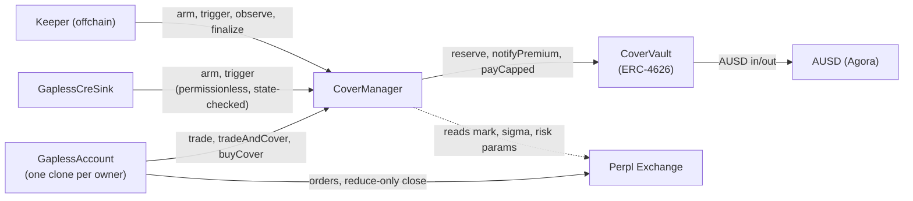

# Gapless contracts

Foundry 1.8.3, solc 0.8.37 (osaka), OpenZeppelin 5.6.1, `network = "monad"`. No fork tests by design — Perpl, AUSD and Chainlink are swapped for conformance-tested mocks in `test/mocks/`.

    foundryup -i 1.8.3
    forge build
    forge test                      # unit, fuzz (256 runs), invariant (64 x 200)
    FOUNDRY_PROFILE=ci forge test   # 1024 fuzz runs, invariant 64 x 200
    FOUNDRY_PROFILE=deep forge test # invariant 256 x 500 (gate: run as 8 chunks of 32 runs, docs/C5_FIXES.md)
    ./script/export-abi.sh          # frozen interface ABIs to abi/

## Contracts (Monad mainnet, chain 143)

| Contract | Address | Role |
|---|---|---|
| `CoverVault` | [`0xab3CB7b3b28366eD7f6C59DbD2D708890919B289`](https://monadscan.com/address/0xab3CB7b3b28366eD7f6C59DbD2D708890919B289) | ERC-4626 LP vault — deposits, premiums, payouts |
| `CoverManager` | [`0xb07C20cb5328d5208A1453521b94beeB3Faa1771`](https://monadscan.com/address/0xb07C20cb5328d5208A1453521b94beeB3Faa1771) | `quote`, `buyCover`, `arm`, `trigger`, `finalize` — the core state machine |
| `GaplessFactory` | [`0xB1a255e9D4CEdC20998ddC67a7Ec5e0B71bd8777`](https://monadscan.com/address/0xB1a255e9D4CEdC20998ddC67a7Ec5e0B71bd8777) | CREATE2 clones of `GaplessAccount` per owner |
| `GaplessAccount` (impl) | [`0xc175a64BcE88dC4AC0Cfefd20daf8826b8c88cDC`](https://monadscan.com/address/0xc175a64BcE88dC4AC0Cfefd20daf8826b8c88cDC) | Owner/operator-scoped trading account |
| `GaplessCreSink` | [`0xB9908Df02187c49cc77905e62bCA73AB28d9FD1B`](https://monadscan.com/address/0xB9908Df02187c49cc77905e62bCA73AB28d9FD1B) | Chainlink CRE report receiver, calls `arm`/`trigger` permissionlessly |

All five verified on Sourcify and Monadscan. Full record with creation transactions and role assignments: [`../deployments/143.json`](../deployments/143.json). Market listed: BTC-PERP (perp ID 1) on [Perpl Exchange](https://monadscan.com/address/0x34B6552d57a35a1D042CcAe1951BD1C370112a6F).

**Verified live, not just tested:** on 2026-10-12 a real cover was bought, closed through the Live fast path, and finalized on mainnet — full tx-by-tx walkthrough with real numbers in the root [`../README.md`](../README.md#the-full-lifecycle-step-by-step-with-a-real-example).

## Tests

508 total: 475 unit, 27 fuzz (1,024 runs each at the `ci` profile), 15 invariants (64 runs × 200 depth). `GaplessOptimization`'s invariants found zero attacker-profitable sequences across the run. Checks-effects-interactions throughout; `ReentrancyGuard` on every value-transfer function; `SafeERC20` for all token interactions; the payout is bounded three independent ways specifically to prevent self-gaming (see [`../MECHANISM.md`](../MECHANISM.md) for the exact formulas).

Frozen interfaces, constants, the Cover state machine and the S1/S2 work split are in `INTERFACES.md`.
Test doubles for Perpl, AUSD and Chainlink live in `test/mocks/` with conformance tests.

## Who calls whom

## Docs

- [Foundry Book](https://book.getfoundry.sh/) · [Solidity 0.8.37](https://docs.soliditylang.org/en/v0.8.37/) · [OpenZeppelin Contracts 5.x](https://docs.openzeppelin.com/contracts/5.x/)
- [Perpl order types](https://docs.perpl.xyz/exchange/order-types.md) · [Perpl liquidation](https://docs.perpl.xyz/exchange/liquidation.md) · [Perpl fees](https://docs.perpl.xyz/exchange/fees.md) — `IPerplMin`/`IPerplEvents` in `test/mocks/reference/` are generated from PerplFoundation's own `dex-sdk` ABIs
- [Agora / AUSD — contract deployments](https://docs.agora.finance/developer/contract-deployments.md) · [Security & compliance](https://docs.agora.finance/developer/security-and-compliance.md)
- [Chainlink CRE — EVM client onchain write](https://docs.chain.link/cre/guides/workflow/using-evm-client/onchain-write/writing-data-onchain) — what `GaplessCreSink` receives
- Root [`../README.md`](../README.md#the-full-lifecycle-step-by-step-with-a-real-example) — a real buy→trigger→finalize cycle against these exact contracts, with tx hashes
