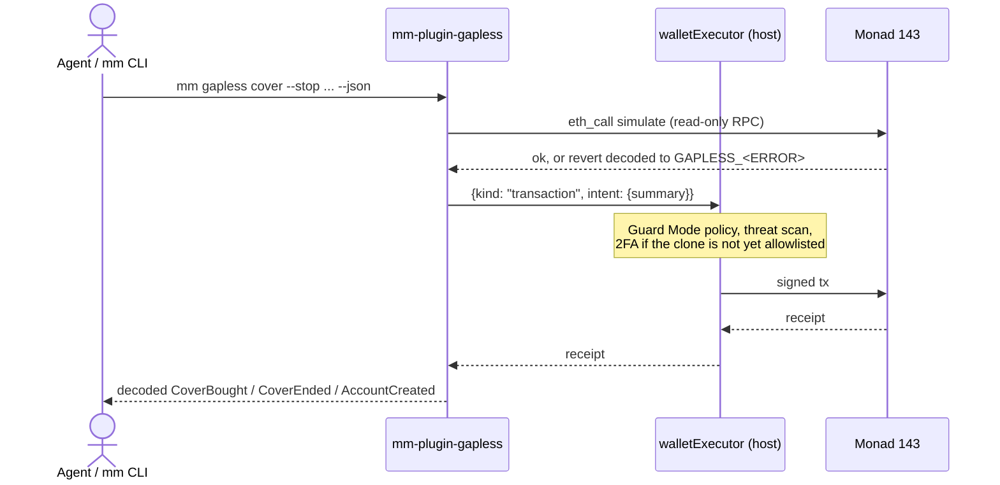

# mm-plugin-gapless

Guaranteed stop-losses on [Perpl](https://perpl.xyz) perps (Monad, chain 143) for [MetaMask Agent Wallet](https://docs.metamask.io/agent-wallet/). If the price gaps through your stop, Gapless closes the position and pays the gap between the stop and the actual close, up to a cap.

## Verified live on mainnet (2026-10-12)

Every command in this plugin has been run for real against Monad mainnet, not just unit-tested:

| Command | Real tx |
|---|---|
| `mm gapless account` | created the GaplessAccount clone with an AUSD deposit |
| `mm gapless trade` | opened a BTC long with a guaranteed stop in one transaction |
| `mm gapless cancel` | cancelled that cover, escrow refunded |
| `mm gapless cover` | bought a fresh stop on the still-open position — [`0x713017…`](https://monadvision.com/tx/0x713017066dfc04e62db4e112ba9e3eb74dd4708a4f32ba3f8cda3554455e7132) |

That last cover was then triggered and finalized automatically by the Gapless keeper — see the root [`README.md`](../README.md#the-full-lifecycle-step-by-step-with-a-real-example) for the full tx-by-tx walkthrough.

**A real upstream bug was hit along the way and is now resolved.** On 2026-10-09, every transaction submission on chain 143 through the Agent Wallet CLI (`@metamask/agent-wallet` 7.0.0/7.1.0) failed with `Gas fee/price estimation failed: "invalid project id" is not valid JSON` — a bug in the CLI's own authenticated gas-estimation call, not in Monad's gas API or this plugin (a plain `curl` to the same endpoint worked fine). Documented in full in [`../audit/METAMASK_GAS_FEE_BUG_REPORT.md`](../audit/METAMASK_GAS_FEE_BUG_REPORT.md) and filed upstream. As of 2026-10-12 the bug is gone and every command above is confirmed working again.

Every transaction goes through Agent Wallet's `walletExecutor`, so signing, Guard Mode policy, threat scanning and 2FA always apply. The plugin holds no keys and sends no raw transactions: signing and broadcasting always go exclusively through the host's `walletExecutor`, with no code path around it. Reads (quotes, status, simulation, receipt polling) use the host's authenticated RPC client by default; if that gateway is unreachable for this chain, they fall back to a direct public RPC (`GAPLESS_FALLBACK_RPC_URL`, default `https://rpc.monad.xyz`) for the rest of the session. This fallback never touches signing or broadcast (plus an optional Envio GraphQL URL you pass yourself for `status --graphql`).

The agent normally acts as the **operator** of a GaplessAccount: the owner signs an onchain grant (per-trade cap, rolling daily budget, expiry, never withdraw) that sits under Guard Mode as a second policy layer.

## Commands

| Command | Capabilities | What it does |
| --- | --- | --- |
| `mm gapless quote` | wallet-read | Price a guaranteed stop (existing position, or `--open` to price open plus cover) |
| `mm gapless trade` | wallet-read, wallet-submit | Open a position and buy the stop in one tx (`tradeAndCover`) |
| `mm gapless cover` | wallet-read, wallet-submit | Buy a stop on an existing position (`buyCover`) |
| `mm gapless cancel` | wallet-read, wallet-submit | Cancel a live stop (`cancelCover`) |
| `mm gapless status` | wallet-read | Active stops, grant, refunds; optional Envio history |
| `mm gapless grant` | wallet-read | Show the grant; fails if this wallet is not the live operator or owner |
| `mm gapless link` | wallet-read, wallet-submit | Print the `SetOperator` typed data for the owner, then submit `setOperatorWithSig` |
| `mm gapless account` | wallet-read, wallet-submit | Owner mode: AUSD `approve(factory)` then `createAccount` |

All commands target chain 143 only and accept the host flags (`--json`, `--format`, `--toon`, `--verbose`). Submit commands take `--dry-run` (simulate only, the executor is never touched). Agents should follow [`skills/gapless/SKILL.md`](../skills/gapless/SKILL.md), which ships inside the package.

## One-time Agent Wallet setup (user)

```bash
npm install -g @metamask/agent-wallet@7.0.0   # Node 22.18 or later
mm login qr                                  # QR with MetaMask Mobile, so 2FA arrives as a push
mm init --mode guard                         # server wallet, Guard Mode
mm doctor                                    # authenticated: true, initialized: true
mm wallet address                            # the agent address the owner grants; fund it with about 0.6 MON on 143
```

## Install

From npm (after publish):

```bash
mm config set experimentalPlugins true
mm plugins install mm-plugin-gapless          # review the consent screen: 8 commands, wallet-submit on 5
mm plugins inspect mm-plugin-gapless
```

From this checkout (development, before publish):

```bash
cd plugin
npm ci && npm run build
mm config set experimentalPlugins true
mm config set experimentalAllowUnverifiedInstalls true
mm plugins link "$PWD"                        # or: mm plugins install "file:$PWD" --accept-permissions
```

Day-1 smoke read (no signing): `mm gapless grant --account <clone> --json`, then `mm gapless status --account <clone> --json`. Uninstall between iterations with `mm plugins uninstall mm-plugin-gapless`.

## Configuration

| Variable | Purpose |
| --- | --- |
| `GAPLESS_COVER_MANAGER_ADDRESS` | CoverManager on 143. Only needed until `scripts/sync-abi.ts` writes `src/addresses.ts` from `deployments/143.json`; once that file has addresses, a different env value is refused |
| `GAPLESS_FACTORY_ADDRESS` | Optional cross-check; otherwise read from `CoverManager.factory()` |
| `GAPLESS_ACCOUNT` | Default for `--account` |
| `GAPLESS_GRAPHQL_URL` | Default for `status --graphql` (https only) |
| `GAPLESS_FALLBACK_RPC_URL` | Read-only fallback when the host's own RPC gateway is unreachable for chain 143. Default `https://rpc.monad.xyz`. Never used for signing or broadcast |

`src/abi/*` and `src/addresses.ts` are generated. They were bootstrapped by hand once on 2026-10-06; from W5 on `scripts/sync-abi.ts` owns them and CI checks for drift. Do not edit them.

## Link the agent (operator mode)

1. Agent prints what the owner signs (key = the active Agent Wallet):

   ```bash
   mm gapless link --account <clone> --max-per-trade 25 --max-per-day 100 --expiry +4h --json > link.json
   ```

2. Owner signs `typedData` from that output. In the Gapless web app use "Grant agent". For an EOA-owned test account with Foundry:

   ```bash
   jq '.typedData // .data.typedData' link.json > grant.json
   cast wallet sign --data --from-file grant.json --account <owner keystore>
   ```

3. Agent submits with the exact values printed in step 1:

   ```bash
   mm gapless link --account <clone> --expiry <unix> --deadline <unix> --max-per-trade 25 --max-per-day 100 --sig <0x...> --json
   mm gapless grant --account <clone> --json   # role: operator
   ```

One operator per account: linking the agent replaces the web app's session key until the owner re-grants it there.

## Guard Mode demo sequence

1. `mm gapless quote BTC long --size 0.001 --stop <stop> --open --account <clone> --json`
2. `mm gapless trade ... --dry-run --json`, then without `--dry-run`. The clone is not allowlisted yet, so the job pauses with `AWAITING_MFA`; approve on MetaMask Mobile.
3. Allowlist the clone: `mm wallet policy get`, add the clone address to the address allowlist, `mm wallet policy set --policy "<yaml>"` (itself 2FA-gated).
4. A second action (for example `mm gapless cancel --market BTC --account <clone> --json`) clears without 2FA, inside the outflow limit.

## Publish (maintainer)

```bash
npm login                                     # account with 2FA
npm whoami
npm view mm-plugin-gapless                    # 404 means the name is still free
cd plugin && npm ci && npm run typecheck && npm test
npm pack --dry-run                            # dist, oclif.manifest.json, SKILL.md, README.md, LICENSE, package.json only
npm publish --access public
```

Then on a clean machine (fresh macOS user or a Node 24 container): the one-time setup above, `mm config set experimentalPlugins true`, `mm plugins install mm-plugin-gapless`, and the smoke read. Publish only after the security review (SE-W3) and after `src/addresses.ts` holds the canary addresses, or users will need `GAPLESS_COVER_MANAGER_ADDRESS`.

## How a submit works

1. Resolve the active wallet exactly like the host (`walletStateManager.read()`, selected EVM wallet); `--from` must match it for submits.
2. Check chain 143, read the wiring from the CoverManager, check the account is a factory clone, and refuse unless this wallet is its owner or live operator.
3. Build calldata from the frozen ABIs. Limits must sit within 500 bps of the mark (contract rule M-01). `maxPremium = quote x (1 + max-premium-bps / 10000)`, default 200 bps, at most 1000. An open-and-cover is priced by simulating `tradeAndCover` with `maxPremium = 0`, which reverts `PremiumTooHigh(need, 0)` with the exact post-trade premium.
4. `eth_call` simulation from the wallet; any revert is decoded against the account, manager, vault, factory, AUSD, inherited OZ and Perpl error ABIs and returned as `GAPLESS_<ERROR_NAME>`. Nothing is signed on a failed simulation.
5. Gas limit = estimate x 1.2, rounded up (Monad bills the limit), refused above 5,000,000.
6. One executor request: `{kind: "transaction", chainId: 143, transaction: {to: clone, data, value: 0n, gas}, intent: {action: "custom", summary}}`. Never retried; a pending 2FA job comes back as `GAPLESS_PENDING` with its pollingId.
7. Wait for the receipt via the host client and decode `CoverBought`, `CoverEnded`, `OperatorSet` or `AccountCreated`.

### walletExecutor shape (not in the public docs)

The public reference only says the executor accepts `transaction`, `message` and `typed-data` requests. The shape above comes from the compiled `@metamask/agent-wallet` 7.0.0 package (`wallet:send-transaction` and `createCliWalletExecutor`):

- `value` and `gas` are **bigint**. The host hex-encodes them itself (`"0x" + v.toString(16)`), so a hex string such as `"0x0"` would be corrupted.
- `intent` is an object `{action, summary}` (the host's `custom` factory), not a string.
- Options: `signal`, `noAwait`, `waitForReceipt`. The plugin passes only `signal`.
- FAILED, BROADCAST_FAILED, DENIED and EXPIRED throw; an interrupted poll rethrows with `pendingJob` attached.

Re-check this against each new `mm` release before bumping `minCliVersion`.



## Docs

- [MetaMask Agent Wallet overview](https://docs.metamask.io/agent-wallet/) · [Quickstart](https://docs.metamask.io/agent-wallet/quickstart.md) · [Build a plugin](https://docs.metamask.io/agent-wallet/plugins/build-a-plugin.md) · [Install a plugin](https://docs.metamask.io/agent-wallet/plugins/install-a-plugin.md)
- [Commands reference](https://docs.metamask.io/agent-wallet/reference/commands.md) · [Trading modes](https://docs.metamask.io/agent-wallet/reference/trading-modes.md) · [Outflow policy](https://docs.metamask.io/agent-wallet/reference/outflow-policy.md) · [Supported chains](https://docs.metamask.io/agent-wallet/reference/supported-chains.md) · [Error codes](https://docs.metamask.io/agent-wallet/reference/error-codes.md)
- [Perpl order types](https://docs.perpl.xyz/exchange/order-types.md) — what `buyCover`/`trade` ultimately close against
- Root [`../README.md`](../README.md#the-full-lifecycle-step-by-step-with-a-real-example) — the real end-to-end run this plugin produced

## Development

```bash
npm ci
npm run typecheck
npm test          # vitest: fake ctx, viem custom transport, spy executor, manifest and npm pack checks
npm run build     # tsc + oclif manifest
```
