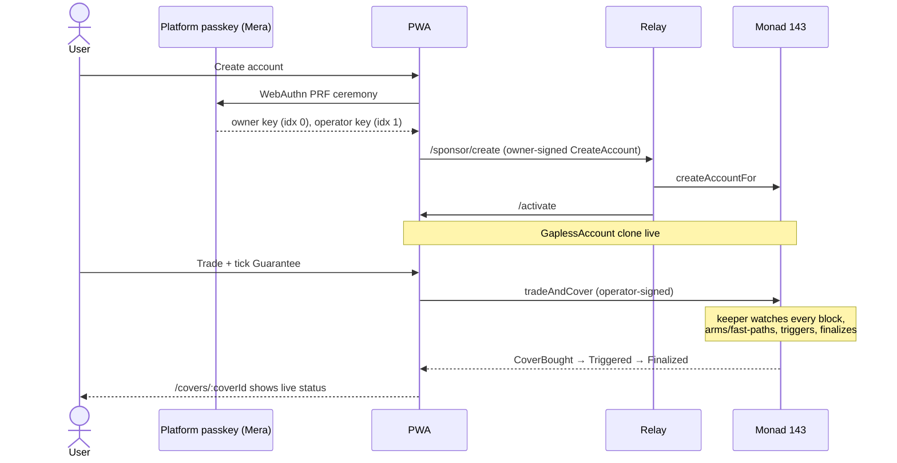

# Gapless PWA

The web client for Gapless — passkey onboarding, trading with a guaranteed stop, the LP vault, and live analytics. Built on the Kwek Labs Web Starter: TanStack Start (static SPA mode), TanStack Router/Query, Tailwind 4, HeroUI v3, Motion. No wallet extension, no injected provider — the only signer is a Mera passkey.

Full technical spec: [`ARCHITECTURE.md`](ARCHITECTURE.md) and [`ARCHITECTURE_PHASE2.md`](ARCHITECTURE_PHASE2.md). Visual design system: [`DESIGN.md`](DESIGN.md). Read those before changing anything non-trivial — this file is just getting-started and conventions.

## Verified live (2026-10-12)

The passkey ceremony itself is verified end to end against a real Chrome WebAuthn PRF ceremony, including a fresh-device reconstruction (clear every `localStorage`/`sessionStorage`/IndexedDB entry, re-authenticate, get back the byte-identical owner address) — see [`../audit/MERA_FRESH_DEVICE_2026-10-09.md`](../audit/MERA_FRESH_DEVICE_2026-10-09.md).

The full trade → guarantee → trigger → finalize lifecycle this app's `/trade` and `/covers/$coverId` pages are built around has also been proven live on Monad mainnet (via the MetaMask Agent Wallet plugin, same contracts this PWA calls) — see the root [`README.md`](../README.md#the-full-lifecycle-step-by-step-with-a-real-example) for the full tx-by-tx walkthrough. No GaplessAccount has yet been created through this PWA specifically on a public deployment (only locally); that's the next real-world milestone.

## Getting started

```bash
bun install
bun dev        # http://localhost:3200
```

Needs a running relay (`backend/`, default `http://127.0.0.1:3700` / `ws://127.0.0.1:3701/ws/market`) for market data, account reads, and sponsored onboarding — see [`backend/RUNNING.md`](../backend/RUNNING.md). `VITE_RP_ID=localhost` is intentional: WebAuthn treats `localhost` as a secure context, so passkeys work over plain `http://localhost:3200` without real TLS.

## Environment

| Variable | Purpose |
|---|---|
| `VITE_RP_ID` | WebAuthn relying-party ID the passkey is bound to. `localhost` for local dev; the real production domain once deployed — a passkey does not transfer between RP IDs |
| `VITE_RELAY_URL` | Relay HTTP base (`/api/*`, sponsor onboarding) |
| `VITE_RELAY_WS_URL` | Relay `/ws/market` WebSocket |
| `VITE_RPC_URLS` | Comma-separated public Monad RPC endpoints (reads only — the PWA never calls a private/keyed RPC) |
| `VITE_EXPLORER_URL` | Block explorer base used for tx links in the UI |

See `ARCHITECTURE.md` section 9.1 for the full list and defaults.

## Routes

| Route | What |
|---|---|
| `/` | Landing |
| `/onboard` | Passkey creation / sign-in, sponsored GaplessAccount creation |
| `/home` | Account overview |
| `/trade` | Plain trades and the Guarantee path (`tradeAndCover` / `buyCover`) |
| `/covers/:coverId` | A single cover's live status (Live → Armed/fast-path → Triggered → Finalized) |
| `/vault` | LP deposit/withdraw, "what LPs can lose" disclosure |
| `/gap-index` | Live oracle-vs-book staleness and pricing analytics (real data, not a static report) |
| `/stats` | Protocol-wide stats (`/api/stats`) |
| `/proof` | Honest measured-mode comparison — no fabricated claims |
| `/settings`, `/settings/agent` | Session settings, MetaMask Agent Wallet grant flow |

A route that needs a signed-in session renders an unlock card in place, never a redirect (`ARCHITECTURE.md` section 4).

## Account model, in short

One Mera passkey derives two keys: **owner** (`m/44'/60'/0'/0/0`, signs typed data only — `CreateAccount`, `SetOperator`, `Withdraw` — and never needs MON) and **operator** (`/1`, sends every transaction, scoped at compile time to a closed set of call destinations, drip-funded by the relay). Neither key, nor the PRF output they're derived from, is ever logged, put in React state outside `lib/account/session.ts`'s module closure, serialized, or sent anywhere. `localStorage` holds only a public passkey credential hint, never key material. Full threat model: `ARCHITECTURE.md` section 8.

## Commands

```bash
bun dev          # watch mode, :3200
bun run build    # production build (needs the VITE_ vars set)
bun preview      # preview the production build
bun test         # Vitest
bun lint         # ESLint
bun format       # Prettier
bun check        # format --write + lint --fix
```

## Conventions

- `cnm()` (`src/utils/style.ts`) for conditional classNames; no raw Tailwind palette classes (`bg-neutral-900`) in app code — use the design tokens in `styles.css`.
- `GaplessButton` wraps HeroUI's `Button` with the porcelain primary variant (`DESIGN.md` 5.1) — use it instead of a raw `<Button>` for user-facing actions.
- Dark only, fixed (`className="dark"` on `<html>`), no light mode toggle.
- `src/abi/*.ts` and `src/config/addresses.143.ts` are generated by `scripts/sync-abi.ts` from `contract/abi/` and `deployments/143.json` — never hand-edit them.
- No barrel files; import directly from source.
- Motion (`motion/react`) is the only JS animation library — reuse the tokens in `src/config/animation.ts` rather than inventing new curves.

## Onboarding → trade → guarantee, in one picture



## Docs

- [Mera](https://mera.category.xyz) · [Security model](https://mera.category.xyz/concepts/security-model/) · [Create passkey accounts](https://mera.category.xyz/recipes/create-passkey-accounts/) · [Send a transaction with viem](https://mera.category.xyz/recipes/send-a-transaction-with-viem/) · [Authenticator support](https://mera.category.xyz/authenticator-support/)
- [Monad network information](https://docs.monad.xyz/developer-essentials/network-information) · [Reserve balance](https://docs.monad.xyz/developer-essentials/reserve-balance)
- [TanStack Start SPA mode](https://tanstack.com/start/latest/docs/framework/react/guide/spa-mode) · [TanStack Router](https://tanstack.com/router) · [TanStack Query](https://tanstack.com/query/latest)
- Root [`../README.md`](../README.md#bounty-tracks--sponsor-integrations) — every sponsor integration this app calls into

## Deployment

Static SPA build (`bun run build`), served from `dist/client/`; the host rewrites every path to `/_shell.html` (see `vercel.json`). Needs `VITE_RP_ID`, `VITE_RELAY_URL`, `VITE_RELAY_WS_URL`, `VITE_RPC_URLS` set at build time. A production deploy needs its own real HTTPS domain — passkeys created against `localhost` cannot be reused there.
